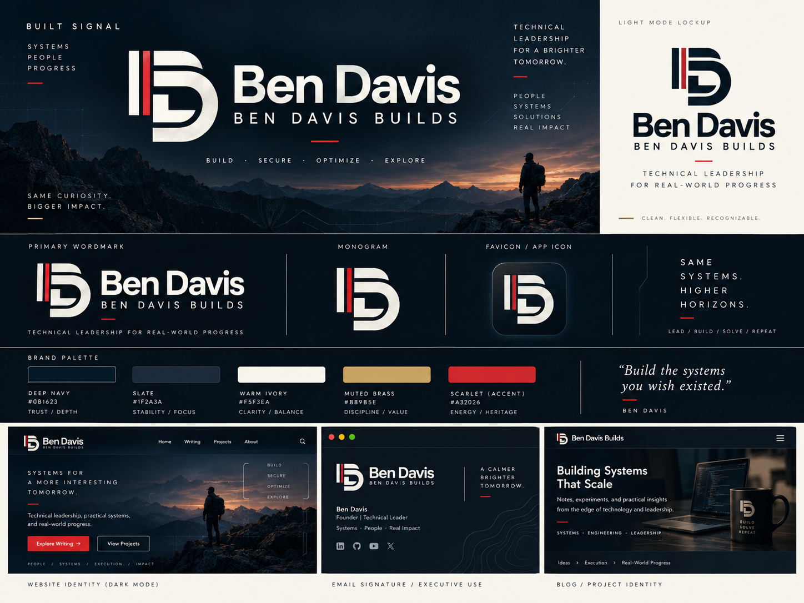

# Built Signal — Brand & Website Build Specification

**Version:** 1.0.0\
**Status:** Approved **visual direction**; production assets and page implementations not yet approved\
**Brand:** Ben Davis / Ben Davis Builds\
**Domain:** `bendavisbuilds.com`\
**Visual source of truth:** [`reference/APPROVED_Built_Signal_Board.png`](reference/APPROVED_Built_Signal_Board.png) — exact image attached and selected by the owner on 2026-10-11\
**Theme:** **Dark first and default**; polished light mode also required\
**Intended readers:** site owner, designer, Codex/AI development agents, reviewers

> **Critical logo invariant:** Use the clean geometric monogram and adjacent vertical scarlet stripe visible in the approved image. There is **NO internal signal/circuit wire, trace, node, orange dot or brass line** in the mark. Do not use the subsequent AI render that added a wire. The words *Built Signal* do not authorize adding circuits to the logo.

## 1. Source-of-truth hierarchy

Resolve conflicts in this order:

1. Explicit, current owner decisions and repository governance/safety constraints.
2. **The approved image above** for overall composition, logo silhouette, wordmark character, colors, hierarchy and dark-mode atmosphere.
3. This spec for production implementation, accessibility, typography intent and approved deviations from the image's conceptual mockups.
4. `design/built-signal.tokens.json` and generated `design/built-signal.tokens.css` for **functional** color roles and consistency.
5. Existing Astro architecture ADR, content rules, deployment requirements and operational runbooks.
6. Older Dress Blues & Brass / Classic Ember guides, prior concept art and speculative mockups (historical context only when conflicting).

**Owner-approved direction is not identical to a finalized vector asset.** The reference is a rasterized visual concept. Production logo geometry must be recreated and compared against it before release. Do not claim to have recovered the original editable vector or precise font from a raster image. Design tokens marked **interpreted production tokens** are tested semantic approximations anchored to the image and require visual approval, not a claim of pixel-perfect extraction.

## 2. Brand goals and exclusions

### Intended brand impression

A technical leader who builds real systems, develops people, understands cybersecurity, experiments with AI and automation, and has a relaxed but competent personality. Visually: precise, warm, cinematic, cyber-tech-aware, approachable, and professional.

- **Executive audience:** trust, clarity, commercial judgment, leadership presence.
- **Technical audience:** credible projects, honest engineering documentation, recognizable infrastructure/AI concepts, no performative hacker gimmicks.
- **Mentoring audience:** supportive, grounded, accessible, easy to approach.
- **Personal identity:** Marine veteran as a meaningful influence, not the entire personality. The blood-stripe-inspired scarlet accent references NCO heritage; it is a custom personal symbol, **not an official USMC mark or color specification**.
- **Personality:** technically curious, security-minded, slightly cyberpunk/gamer; tasteful rather than juvenile.

Avoid camouflage, military rank logos, flags as default decoration, skulls, hacker hoodie imagery, Matrix rain, neon overload, faux terminal logs and invented performance/career claims.

## 3. Approved logo system

### 3.1 Geometry and visual features (LOCKED)

- Primary symbol: the **existing bold ivory/white geometric BD-style mark** as seen in the attached board. Do not substitute a new alphabetic or circuit symbol.
- Scarlet: **one narrow, straight vertical red stripe** immediately beside the mark's left vertical structure; it is intentional and recognizable in both modes.
- Shape: simple strong strokes, squared/rounded geometry consistent with the selected image; preserve whitespace/negative space and distinctive lower/right curvature.
- In the logo itself: **no wires, traces, PCB motifs, internal wiring, nodes, sparks, paths, plus signs, gradients or decorative signal elements**.
- Do not add an additional scarlet dot or make the logo resemble a network rack vendor mark.
- The symbol should work **without** a background and be recognizable in monochrome with the stripe as an optional accent.
- Wordmark: **Ben Davis** in large modern geometric sans-serif, with **BEN DAVIS BUILDS** beneath in tracking-heavy uppercase.
- Logo is independent of the tagline. Avoid baking unapproved marketing copy into permanent SVG wordmark artwork.

### 3.2 Deliverable variants (REQUIRED BEFORE PRODUCTION)

| Asset | Purpose | Visual rules |
|---|---|---|
| Horizontal lockup, dark | Header, dark presentations | Ivory symbol/wordmark on navy; scarlet stripe |
| Horizontal lockup, light | Light website, print | Navy symbol/wordmark on warm ivory; scarlet stripe |
| Standalone BD monogram | Compact identity, social/avatar | Same geometry as lockup; do not redraw it differently |
| App icon / favicon | Browser tab, touch icon, PWA future | Same mark on navy square, simplification only for small size |
| Single-color fallback | Print/forced colors | Legible identity when brand colors are unavailable |

Create hand-auditable SVG files and raster exports from **one underlying geometry**. Recommended raster targets: 16, 32, 48, 180, 192 and 512 px where appropriate. Verify recognizability at 16×16 and 32×32. A square icon may have gently rounded **container corners**; the mark itself is unchanged.

**Acceptance gate:** Owner visually approves a zoomed SVG comparison against the chosen board before any agent calls it the final logo. Do not auto-vectorize a full moodboard or use the moodboard crop itself as the production logo.

## 4. Core palette and theme architecture

### 4.1 Colors visible on the approved board (reference swatches)

| Visual role | Hex shown in attached image | Treatment |
|---|---|---|
| Deep navy | `#0B1623` | Dominant dark-mode page canvas |
| Slate | `#1E2A3A` | Secondary panels, elevated dark UI |
| Warm ivory | `#F5F3EA` | Light-mode page / primary light logo color |
| Muted brass | `#B89B5E` | Small decorative trims, dividers and details |
| Scarlet | `#A32026` | Narrow stripe and select signature marks |

**Classic Ember:** The earlier approved orange identity swatch `#E87722` remains an **optional supporting accent** for selected technical illustrations or occasional editorial details. It is intentionally *not* part of the five-swatch Built Signal board. Do **not** insert orange into the monogram, use orange site-wide, or reinterpret the scarlet stripe as orange.

### 4.2 Semantic production tokens

The reference image conveys an aesthetic; its five swatch colors alone do not define readable controls. `design/built-signal.tokens.json` adds accessible text, links, borders, focus rings and surface gradations for both themes. The CSS is compiled/synchronized from that JSON; **never scatter raw hex codes throughout components**.

**Dark mode — default:** `#0B1623` canvas, `#1E2A3A` panels, `#F5F3EA` primary text, soft slate text, restrained scarlet/brass accents. Light-mode text is not obtained via CSS inversion.

**Light mode:** `#F5F3EA` warm page; warmer off-white / beige cards, navy text, clearly visible control borders; no broad pure-white walls.

Functional text links use `accentText` (mode-specific accessible shade) rather than the orange decorative swatch. Scarlet is personal branding, **not** the semantic error color. Do not use red versus orange versus green alone to express meaning.

### 4.3 Theme state behavior

- **Initial visit** without saved preference: **dark** (explicit owner choice).
- Visible user controls: **Dark / Light / System**.
- System option follows `prefers-color-scheme`; it does not replace the chosen dark-first default.
- Persist `dark`, `light`, or `system` in local storage if available; catch storage errors.
- Apply saved preference before first paint where practical to avoid theme flash. CSS must support a usable dark default without JavaScript.
- Honor browser/OS forced-color mode and `prefers-reduced-motion` regardless of chosen theme.
- Never force dark mode just for the lab; visitors may use light mode there too.
- Test all components in both modes; text contrast checks are necessary but not sufficient for accessibility conformance.

## 5. Typography and spacing (proposed production choices)

**The raster concept does not reveal a reliable exact font family.** Production typography remains a **provisional match** until owner approval.

| Role | Recommended production starting point | Intent |
|---|---|---|
| Wordmark and display | Manrope or similar clean geometric sans | Strong, modern, not aggressive |
| Article and UI body | Inter with system fallback | Long-form legibility |
| Code, topology labels | IBM Plex Mono or system monospace | Technical precision with restraint |
| Select editorial quote | Restrained serif or italic | Human warmth, never for long UI labels |

- Body text: `1rem` minimum; long-form articles ~`1.125rem`, `line-height: 1.65–1.8`, measure about 65–70 characters.
- Header labels and actionable metadata: do not copy the tiny legibility-compromised text baked into the moodboard. Typically at least 14 px for important labels.
- Main shell: ~1200–1240 px max width; comfortable gutters and generous separation.
- Spacing scale: 4, 8, 12, 16, 24, 32, 48, 64, 96 px.
- Cards: modest radius 3–6 px, thin borders, restrained shadows. No neon or glassmorphism as a default.
- Logo geometry: crisp SVG and good whitespace; no glow around it.
- Small uppercase overlines and divider dashes are permitted; body copy must remain readable sentence case.

## 6. Page families and visual density

| Route/page | Visual language | Interaction |
|---|---|---|
| `/` Home | Dark-first atmospheric introduction, logo, leadership descriptor, feature panels; restrained system texture | Simple nav, optional small animated technical preview |
| `/about` | Editorial narrative, leadership/engineering trajectory, veteran reference as one meaningful layer | Mostly static |
| `/writing` | Reading-first article directory, metadata, filters/search | Mostly static; small JS as justified |
| `/writing/[slug]` | Accessible Markdown/MDX long-form article, code, diagrams | Static by default |
| `/writing/archive` | Chronological legacy WordPress material, clearly labeled historical | Read/search, no implied current safety of old commands |
| `/projects` | Project portfolio and detailed experiments | Static summaries with optional interactive showcases |
| `/projects/lab` | Mission Control-inspired architecture and agent workflows | React island(s), labeled read-only snapshot/simulation |
| `/mentorship` | Straightforward mentoring tracks and Google Workspace booking links | No unnecessary custom booking backend |
| `/contact` | Professional contact links, optional safe inquiry integration | No raw credentials in browser |

**Navigation for Alpha (proposed):** Home · About · Writing · Projects · Mentorship · Contact. Keep Archive within Writing and Lab within Projects; owner may reorder final navigation.

### Design density

- Home / About / Mentorship: **low technical density**, readable and human.
- Writing / Archive: **editorial-first** with useful code/diagram examples.
- Projects / Lab: **higher technical density** with purposeful topology, state and engineering detail.
- All pages inherit the **same** typography/color tokens and identity; do not build a separate visual brand for the Lab.

## 7. Imagery and editorial production

The attached board's mountain/dusk/person imagery establishes **cinematic atmosphere**, not a mandatory outdoor-adventure motif. Treat it as concept art, not evidence that the person depicted is the site owner.

- Prefer actual screenshots of projects, custom diagrams, architecture figures and verified work.
- Atmospheric photography can appear sparingly on the homepage or project hero. Ensure copy remains selectable HTML text, never baked into hero-image pixels.
- Photograph/illustration files must have usable rights and alt text where informative; decorative textures are hidden from assistive technologies.
- Avoid invented datacenter screenshots, fake telemetry, fictitious customers or fabricated statistics.
- Wordmark, content and UI must still look complete without cinematic media loaded.
- Tone: clear, calm, competent, a little personality and humor; not hype, forced military rhetoric, or faux hacker jargon.

## 8. Motion, diagrams and Mission Control

- Use accessible **SVG + CSS** for simple lines, node diagrams, logo-adjacent decoration and article animations.
- Use Mermaid as **pre-rendered content** in articles when appropriate; do not load the entire Mermaid editor in readers' browsers by default.
- Use TypeScript + narrowly hydrated React for the interactive architecture explorer, state controls, inspectable workflow and future dashboards.
- Avoid animated GIFs for long demos; use accessible video (AV1/WebM/MP4 depending on compatibility) with poster and controls when more efficient.
- Do not introduce an animation runtime or WebGL scene solely to make the homepage look 'cyber'. Require measured value and client budget review.
- Motion must respect reduced-motion preference. Ongoing animation needs an easy **Pause** control and a meaningful still state.
- Information must survive without motion, color, audio or pointer input.
- Interactive technical panels must never call private privileged lab endpoints from the browser.
- The public lab starts **CONCEPT/SIMULATED/REVIEWED SNAPSHOT, read-only**. Always label data source and freshness accurately. No invented 'LIVE' statuses.

## 9. Application architecture (Alpha)

**Accepted decision:** Astro + strict TypeScript + limited React islands, static output; Markdown/MDX content collections; CSS custom properties; no database or server runtime on the public VPS for Alpha.

Hosting: **Akamai Cloud 2 GB shared CPU**, Ubuntu, Caddy file server; the production VPS does **not** compile the site. Build in GitHub Actions, deploy immutable/static release artifact, retain rollback; no Docker or Kubernetes required.

- GitHub repository is authoritative for source code, content, design tokens and IaC, but is not a backup for future databases or uploaded user data.
- Provision infrastructure through reviewed OpenTofu/Terraform, OS via Ansible; manual server actions for documented bootstrap/recovery only.
- Deployment: least-privilege SSH/service identities, secret-free repo, automated CI checks, independent review before significant merge/deploy and owner approval for public publication.
- Reserved future backend options: Go for bounded APIs/infrastructure integration, Python for AI-assisted workflows. Introduce only against a concrete use case and separate ADR.
- Keep WordPress SQL exports and email/account data **outside** a public GitHub repository. Migrate sanitized article text and approved media only.
- Keep published lab data separate from privileged homelab and admin interfaces; use approved JSON/MDX exports initially.

## 10. Performance contract (initial budgets)

These are **targets to verify**, not achieved measurements.

| Metric | Alpha target | Test method |
|---|---|---|
| Article initial page JS | 0–15 KB compressed | Inspect built route assets |
| Homepage initial JS | ≤30 KB compressed | Build manifest / network waterfall |
| Interactive Lab initial JS | Provisional ≤180 KB compressed | Isolated route measurement; approve justified exceptions |
| Mobile Lighthouse Performance | 95+ lab target | Consistent simulated throttling in CI |
| LCP | ≤2.5 s at p75 | Field Core Web Vitals once traffic permits |
| INP | ≤200 ms at p75 | Field telemetry |
| CLS | ≤0.1 at p75 | Field telemetry |

Self-host or locally bundle lightweight fonts/assets where licensing allows, compress through Caddy, prerender primary content, size images responsively, lazy-load below-fold media, and reserve dimensions to prevent layout shift. Do not sacrifice accessibility or meaningful content to achieve a Lighthouse score.

## 11. Accessibility, security and UX acceptance

- WCAG 2.2 AA design/build target. Normal text contrast ≥4.5:1; essential UI boundaries and meaningful graphical objects ≥3:1 against adjacent colors. Internal body-text target ≥7:1.
- Clearly distinguish navigation, focus, visited/active/selected controls without relying on hue alone. Underline meaningful inline links; use labels/checkmarks/shape differences in charts and topology.
- Keyboard focus visible and never hidden by sticky overlays; controls have accessible names, proper state semantics and logical tab order.
- Content works at 200% zoom and mobile widths; native text resizing and OS forced-colors supported.
- Dark mode default does **not** excuse reduced contrast. Test dark and light variants independently, including forms, popovers, dialogs and errors.
- Do not load hidden third-party tracking scripts, expose addresses/secrets or make unapproved external calls from the Lab page.
- User data, bookings, inquiries and future admin sections must have explicit privacy/security handling before shipping.
- Don't infer real personal facts, past employers' endorsements, metrics, job titles or military-specific achievements from artwork.

`verification/check_tokens.py` tests the specified color-role pairs. Passing color tests does **not** prove the built pages meet WCAG; run keyboard, screen-reader, contrast, zoom, forced-color, performance and responsive checks separately.

## 12. Release plan and acceptance gates

### Gate 0 — Repository review / groundwork

- Read existing `AGENTS.md`, runbooks, ADR and repo conventions; update rather than duplicate.
- Place the exact source image in `design/reference/APPROVED_Built_Signal_Board.png`.
- Mark previous contradictory palette and logo documents as superseded; preserve their history, don't silently delete.
- Import new semantic token JSON + generated CSS; run validation.

### Gate 1 — Logo proof (OWNER APPROVAL REQUIRED)

- Supply standalone full-size vector, horizontal dark and light lockups, favicon proofs at 16/32 px.
- Compare side by side against the approved image.
- Explicitly confirm **no internal wire**. Do not bake unapproved tagline into logo.
- Check on both light and dark surfaces and in high-contrast/monochrome.

### Gate 2 — Site shell

- Astro scaffold, design tokens, dark-default theme controls, responsive navigation and skeleton pages.
- Accessible pages load without optional React JS.
- Screenshots at 390, 768 and 1440 px across **both themes**.

### Gate 3 — Alpha content

- Home, About, Writing, Archive, Projects/Lab, Mentorship, Contact; real content or clearly labeled placeholders only.
- Preserve dates and version caveats on WordPress archive articles; verify sanitization and no leaked metadata.
- Provide sitemap, robots, RSS and canonical domain wiring.

### Gate 4 — Verification and release

- Build, lint, tests, content validation, a11y checks, contrast, device sizes, performance budgets, lighthouse and dependency audit.
- Independent review and owner's explicit approval for public deployment.
- Deploy static site to Caddy on Akamai, verify DNS/TLS/cache/compression and test rollback.

### Definition of done for the *brand spec*

- [x] Exact approved image identified as sole visual reference.
- [x] Dark-first behavior established.
- [x] Clean non-wired logo invariant documented.
- [x] Primary semantics and supporting technology decisions documented.
- [ ] Final production vector and its geometry approved by owner.
- [ ] Font pairing and final tagline hierarchy reviewed by owner.
- [ ] Photography/media rights and final copy verified.
- [ ] Implemented site tested at all release gates.

## 13. Decisions still open (do not silently invent)

1. Exact vector contours of BD and measured scarlet stripe spacing. **Must reference original image and receive owner approval.**
2. Final font licenses/weights; recommendations above are provisional matches.
3. Homepage tagline: "I lead teams. I still build." remains **provisional**; "Technical leadership for real-world progress" may serve as a descriptive line but is not a locked claim/slogan.
4. Exact hero photography/illustration. The hiker and mountain are inspiration, not required assets and not a photo of Ben.
5. Final nav ordering, specific first posts and mentorship appointment availability.
6. Whether Classic Ember appears at all in the production site beyond article illustrations. It is **not** to be inserted into the chosen logo.

## 14. Agent instruction: stop conditions

An agent MUST stop and request a design decision rather than improvising if it needs to:

- Modify the symbol silhouette or reposition/remove the blood stripe.
- Introduce circuit wires, node endpoints, glow or other decorative marks to the BD logo or favicon.
- Swap the chosen navy/ivory foundation or force light-mode as default.
- Invent a finalized slogan or represent an illustrative project metric as real.
- Introduce a permanent server-side framework/database/containers, paid subscription or new external runtime dependency without justification and approval.
- Expose network topology, operational secrets or direct administration controls on the public website.

**The selected image is not one of several alternatives. It is the reference. The next design iteration is vector fidelity and readable production implementation, not a new brand exploration.**
